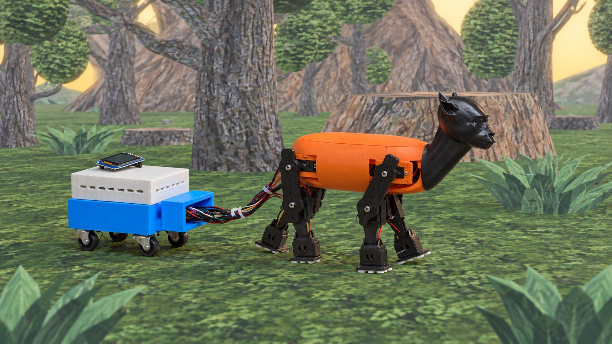
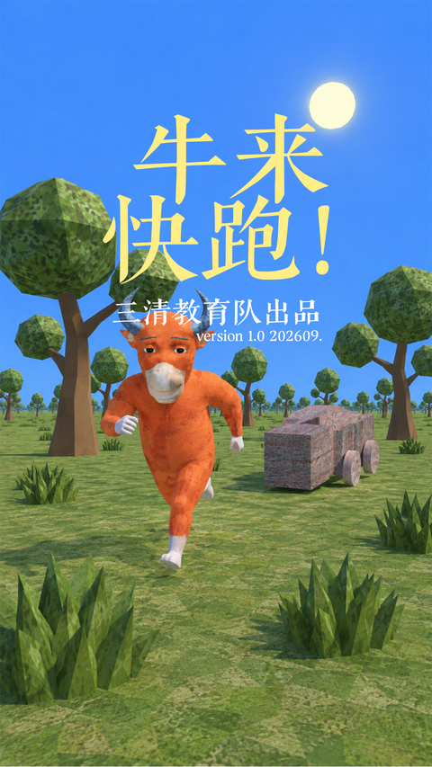
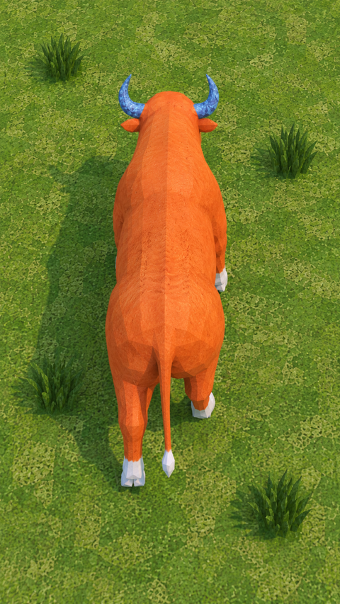

> **⚠️ 免责声明**
>
> **这是参加硬件设计大赛的参赛项目代码仓库，不是任何教程或产品。请不要凭本仓库内容尝试自行复现。**

<p align="center">
  
  <br>
  <sub>牛来快跑概念渲染图</sub>
</p>

<p align="center">
  
</p>

<h1 align="center">牛来快跑</h1>

<p align="center">
  一个把“四条腿怎么走”交给玩家的四足机器人游戏原型。
</p>

<p align="center">
  
  
  
  
  
  
</p>

牛来快跑是一个“人机协同”的四足机器人项目：玩家在 Android 手机上按住 `FL / FR / RL / RR` 四个区域，分别控制左前、右前、左后、右后四条腿抬起、摆动和落下；ESP32-S3 负责 BLE 输入、动作状态机、ARD-1 运动策略、舵机输出、触地反馈、姿态保护、TFT HUD 和音频反馈。

它不是一个自动导航机器人，也不是一套完整的步态规划器。**玩家决定何时迈哪条腿，控制器只负责把玩家的意图安全、连续地变成关节动作。** 四条腿各管各的，协调全靠玩家——这就是“牛来快跑”的玩法核心。

> 项目目前是可复现的**原型基线（v1.0）**。软件回归、固件构建和 Android 构建已有记录；实体舵机幅度、触地、屏幕、音频和长时间运行仍需要台架验收。请先阅读[安全边界](#安全边界)。

---

## 目录

- [项目亮点](#项目亮点)
- [界面预览](#界面预览)
- [系统架构](#系统架构)
- [仓库结构](#仓库结构)
- [快速开始](#快速开始)
- [怎么玩](#怎么玩)
- [安全边界](#安全边界)
- [硬件](#硬件)
- [测试与验证](#测试与验证)
- [已知限制](#已知限制)
- [文档地图](#文档地图)
- [参与贡献](#参与贡献)
- [许可证与致谢](#许可证与致谢)

---

## 项目亮点

| | |
| --- | --- |
| **玩家主导的步态** | 四条腿分别由四个触控区控制，支持按住、保持、释放；最多两条腿同时动作，不自动选腿、不自动补步。 |
| **可解释的运动策略** | 正式运行时使用 `ARD-1 / PastureStep-Reserve` 四腿策略，输出公共 `FL/FR/RL/RR` 关节目标；几何、脉宽和时序都有独立测试。 |
| **默认安全** | 公共默认构建为 `BLE_ONLY`：`/OE` 始终为高，PCA9685 不初始化，动作命令只进入空执行器。实体动作必须显式使用台架 profile，并经过加密绑定、500 ms 看门狗、1 s 接受窗口和安全门。 |
| **分层固件** | 纯 C 控制/协议核心可在普通 gcc 下测试；PCA9685、KW10、MPU6500、ST7789、I²S 通过 HAL/adapter 接入，替换硬件不需要改玩法。 |
| **完整的手机端** | Jetpack Compose 控制器包含单人/双人模式、有效步评分、触地反馈、摔倒失败结算、HOME 安全归位、可选 AI 赛后评价，以及完全离线的 Test Ctrl。 |
| **可追溯的工程记录** | 仓库保留 42 份编号实验记录和 20 份 Decision Record，区分“已观测事实”“假设”和“待验证项”，失败结果同样保留。 |
| **软硬件一体** | 包含 ESP32-S3 固件、Android App、Python 参考控制层、KiCad 原理图、Gerber、BOM、台架工具和 host 测试。 |

---

## 界面预览

| 首页 | 实体控制页 |
| :---: | :---: |
|  |  |

Android 应用名为 **“牛来快跑”**。主界面可以进入实体控制、无设备测试和评价服务设置；实体控制页显示四条腿的按压/触地状态、BLE 连接、动态加速度和游戏计时。

---

## 系统架构

```text
┌─────────────────────────────────────────────────────────────┐
│ Android Controller (Kotlin / Jetpack Compose)               │
│  Main → Connect → Ctrl / Test Ctrl → Result                 │
│  BLE Central · 100 ms 心跳 · 单人/双人 · 评分 · 可选 AI 评价 │
└───────────────────────────┬─────────────────────────────────┘
                            │ BLE GATT, encrypted bonded link
                            │ CONTROL_STATE / STATUS / HOME_COMMAND
                            │ IMU_TELEMETRY / GAME_MODE / AUDIO_COMMAND
                            ▼
┌─────────────────────────────────────────────────────────────┐
│ ESP32-S3 Runtime (ESP-IDF v5.5 + ESP-NimBLE)                │
│                                                             │
│  ble_input ──► watchdog ──► control_task ──► motion_strategy │
│       │                         │                 (ARD-1)    │
│       │                         ▼                            │
│       │                    safety_gate ──► PCA9685 ──► 8×舵机 │
│       │                         ▲                            │
│  foot_contact ──────────────────┤                            │
│  MPU6500 / fall_detector ───────┤                            │
│  ST7789 HUD · I²S audio · voice keyword (optional)           │
└─────────────────────────────────────────────────────────────┘
```

关键不变量：

- **任何执行器帧都必须经过 `safety_gate`。** BLE、显示、音频、语音和遥测都不能直接授权舵机动作。
- **`/OE` 是动作禁止，不是断电。** 启动第一件事就是把 `/OE` 拉高；只有安全门在 `ACTUATION_ENABLED` 且所有条件满足时才允许拉低。
- **断链即失效。** 超过 500 ms 没有有效控制包，固件清零输入并进入 `FAILSAFE`。
- **摔倒即停机。** MPU6500 检测到 Roll/Pitch 绝对值超过 60° 并持续满足条件时，清空输入、保持 `/OE` 高，并通知 Android 本局失败。

更完整的协议见 [`docs/BLE_PROTOCOL.md`](docs/BLE_PROTOCOL.md)，软件分层见 [`docs/architecture/ESP32_SOFTWARE_ARCHITECTURE_v1.md`](docs/architecture/ESP32_SOFTWARE_ARCHITECTURE_v1.md)。

---

## 仓库结构

```text
niulai/
├── firmware-esp32/          ESP32-S3 ESP-IDF 固件
│   ├── main/                应用入口、控制任务、安全门、HUD、音频
│   ├── components/          BLE、PCA9685、KW10、MPU6500、ST7789、MP3 等
│   ├── tests/host/          无需 ESP-IDF 的纯 C host 测试
│   └── tools/servo-zero-test/ 隔离的 PCA9685 舵机标定/诊断固件
├── android-controller/      Kotlin + Jetpack Compose 控制器
├── firmware/                Python 参考控制层（FSM / mock / PCA9685）
├── hardware/
│   ├── electronics/         Carrier v0.2 原理图、Gerber、BOM、评审记录
│   ├── mechanical/          机械记录与 CAD 入口
│   └── prototypes/          短期实体原型记录
├── docs/                    协议、架构、规格、Decision Records、排障手册
├── experiments/             42 份编号实验与原始日志
├── services/feedback_proxy/ 可选的本地 AI 赛后评价代理
├── tools/                   host 诊断、舵机台架、BLE 调试和文档检查
├── docs/images/             README 使用的界面截图
├── requirements-dev.txt     host 工具测试所需的 Python 依赖
└── THIRD_PARTY_NOTICES.md   第三方组件与素材声明
```

---

## 快速开始

### 0. 只跑软件回归（不需要硬件）

```bash
python3 -m pip install -r requirements-dev.txt
sh tools/run_offline_checks.sh
```

这条命令会运行：

- Python 参考控制层测试；
- host 工具测试；
- 赛后评价代理测试；
- Carrier 纸面检查；
- ESP32 纯 C host suite；
- 隔离舵机数学测试；
- Markdown 链接、实验索引、Decision 索引检查；
- 空白检查。

设置 `NIULAI_RUN_ANDROID=1` 可在本机 Android SDK/JDK 就绪时追加 Android 单元测试。

### 1. 构建 ESP32 固件

要求：

- ESP-IDF **v5.5.x**（项目基线为 v5.5.5）
- ESP32-S3 工具链
- 目标板：`ESP32-S3-WROOM-1-N16R8`（16 MB flash / 8 MB octal PSRAM）

```bash
cd firmware-esp32
idf.py set-target esp32s3
idf.py build
```

默认构建是 **`BLE_ONLY` 安全档**：`/OE` 保持高，PCA9685 不初始化，适合先验证 BLE、显示或音频。

要显式启用台架动作，使用独立 build 目录和 bench overlay：

```bash
cd firmware-esp32
idf.py -B build-bench \
  -D SDKCONFIG_DEFAULTS="sdkconfig.defaults;sdkconfig.bench.defaults" \
  set-target esp32s3 build
```

> `ACTUATION_ENABLED` 只是“允许动作”，不是“无条件动作”。运行时仍要求加密绑定链路、持续有效控制包、1 s 接受窗口、四路触地就绪、无 FAILSAFE、无执行器故障。

烧录并监听：

```bash
idf.py -B build-bench -p /dev/ttyACM0 flash monitor
```

Windows 使用 `COMx`。烧录偏移以本次构建生成的 `build/flasher_args.json` 为准，不要手工猜测或复用旧镜像。

### 2. 构建 Android App

要求：

- JDK 17
- 本机可用的 Android SDK（项目构建配置为 `compileSdk 36`，Android Studio 会自动安装；运行 APK 本身只要求 Android 8.0+）
- Gradle 8.13（仓库自带 wrapper）

```bash
cd android-controller
./gradlew testDebugUnitTest assembleDebug
```

Debug APK 输出：

```text
android-controller/app/build/outputs/apk/debug/app-debug.apk
```

安装到 Android 8.0+ 手机，授予蓝牙权限后即可扫描 `牛来快跑` 设备。没有硬件时可以从首页进入 **“不连接设备，进入测试”**，完整体验控制、评分和结算流程。

### 3. 运行 ESP32 host 测试

```bash
sh firmware-esp32/tests/host/run_host_tests.sh
```

这套测试只依赖普通 gcc，不需要 ESP-IDF、开发板或舵机；它会同时检查纯 C 源码中是否混入了 ESP-IDF/FreeRTOS 依赖。

---

## 怎么玩

1. 打开 Android App，进入“开始” → 搜索并连接 `牛来快跑`。
2. 连接完成后进入控制页，四个大按钮对应四条腿：
   - 左上 `FL`、右上 `FR`、左下 `RL`、右下 `RR`；
   - **按下**开始抬腿，**保持**决定摆动时间，**松开**进入寻地/落脚；
   - 最多两条腿同时处于动作状态。
3. 页面底部显示 KW10 触地状态、动态加速度和固件 `STATUS`。触地成功时会显示“完美触碰”。
4. 点击 **“牛来”** 让机器人播放内置的 `牛来叫妈妈.mp3`；它不会触发运动。
5. 点击 **“归位”** 发送认证 `HOME_COMMAND`，固件回到校准静息姿态并报告 `HOME_COMPLETE`。
6. 结束实体游戏时，App 会先发中立控制包，再发送 HOME，等待固件完成静息后主动断开；断开钩子执行 PCA9685 safe-stop 并关闭输出。

模式：

- **单人模式**：一名玩家控制四条腿。
- **双人模式**：同一台手机左右分区，玩家 A 控制 `FL/RL`，玩家 B 控制 `FR/RR`；系统不会补全或预测任何输入。

评分基于“有效步”：测试模式用模拟的按下—松开计步；实体模式要求固件确认“应用 → 离地 → 释放 → 重新触地”才算一步。少于 3 步显示试跑数据；摔倒失败固定为速度分 0、协调分 0。权重和时序窗口仍在台架校准中。

---

## 安全边界

> **这不是玩具级的“随便通电”项目。** 舵机堵转、电源瞬态、I²C 干扰和机械限位都可能造成损坏或人身风险。

在给舵机上电之前，必须确认：

- 机器人已机械固定，腿部运动范围内无人、无工具、无线缆；
- 6 V 舵机电源有限流能力，主回路装有规定的 **10 A ATO/ATC 保险**；
- 可以**立即断开 XT30 主电源**；`/OE` 不是断电开关，只是动作禁止；
- 已核对八个关节的通道映射、零位、方向和机械限位；
- 首次测试从低幅度、单腿、短时开始，并有人全程观察；
- 出现异响、撞限位、过流、掉压、发热或异常动作时，立即断电。

公共默认构建是 `BLE_ONLY`，不会输出舵机 PWM。`BLE_VERIFIED` 只初始化 PCA9685 到安全值并保持 SLEEP，也不会拉低 `/OE`。只有显式构建的 `ACTUATION_ENABLED` 台架镜像才可能产生动作，而且仍受安全门约束。

详细上电流程见 [`docs/I2C_SERVO_TROUBLESHOOTING_GUIDE.md`](docs/I2C_SERVO_TROUBLESHOOTING_GUIDE.md)、[`docs/NACK_POWER_DIAGNOSIS_CASE_STUDY.md`](docs/NACK_POWER_DIAGNOSIS_CASE_STUDY.md) 和 [`hardware/electronics/MODULAR_CARRIER_HARDWARE_SPEC_v0.2.md`](hardware/electronics/MODULAR_CARRIER_HARDWARE_SPEC_v0.2.md)。

---

## 硬件

当前硬件基线是 **Modular Carrier v0.2**：单路 6 V XT30 输入、外部 10 A 保险、LM2596S 生成 3.3 V、PCA9685 驱动八路 MG90S 级舵机、ESP32-S3 作为主控；MPU6500 和 ST7789 通过通用 GPIO/电源 breakout 飞线接入。

| 项目 | 内容 |
| --- | --- |
| 主控 | ESP32-S3-WROOM-1-N16R8 |
| 执行器 | 8× MG90S 级舵机，PCA9685 50 Hz PWM |
| 足端 | 4× KW10 C-NC 开关，固件去抖 |
| 姿态 | MPU6500，I²C，Roll/Pitch 摔倒检测 |
| 显示 | ST7789 170×320 / 320×170 RGB565 HUD |
| 音频 | MAX98357A + 扬声器；MS4030 麦克风（可选语音诊断） |
| 电源 | 单 XT30 6 V 输入，10 A 保险，LM2596S 3.3 V |
| PCB | 2 层 FR-4，KiCad 原理图 + Gerber + BOM |

硬件资料入口：

- [`hardware/electronics/schematic/`](hardware/electronics/schematic/)：KiCad 原理图、PDF/SVG、BOM、网络表、ERC；
- [`hardware/electronics/manufacturing/gerber/`](hardware/electronics/manufacturing/gerber/)：制造 Gerber 与放行记录；
- [`hardware/electronics/HARDWARE_PARAMETER_REGISTER_v0.1.md`](hardware/electronics/HARDWARE_PARAMETER_REGISTER_v0.1.md)：尚未实测/未冻结的电气参数；
- [`hardware/electronics/MODULAR_CARRIER_HARDWARE_SPEC_v0.2.md`](hardware/electronics/MODULAR_CARRIER_HARDWARE_SPEC_v0.2.md)：电源、接口和机械约束。

> Gerber 已做过电气/机械评审，但“能制造”不等于“已装配验收”。PCA9685 供电路径、舵机电流、公共地、保险丝、连接器和机械限位仍需按台架记录确认。

---

## 测试与验证

| 入口 | 覆盖 | 是否需要硬件 |
| --- | --- | --- |
| `sh tools/run_offline_checks.sh` | Python/工具/代理/Carrier 纸面检查/纯 C host/文档审计 | 否 |
| `sh firmware-esp32/tests/host/run_host_tests.sh` | BLE 协议、看门狗、FSM、ARD-1、安全门、PCA9685、HUD、音频、MP3 解码 | 否 |
| `./gradlew testDebugUnitTest` | Android 协议、输入、评分、路由、BLE ViewModel | 否（需本机 Android 构建环境） |
| `./gradlew assembleDebug` | Debug APK 构建 | 否（需本机 Android 构建环境） |
| 台架流程 | 实体 BLE 配对、舵机方向/幅度、触地、IMU、TFT、音频、电源 | 是 |

host 测试不是硬体验收的替代品。仓库把“软件验证通过”和“实体台架通过”分开记录，避免把构建成功写成动作已验证。

---

## 已知限制

- **没有完整步态规划器。** 不自动选择下一条腿、不生成完整 gait、不自动补步、不做全身平衡；这些是明确的非目标，不是遗漏。
- **舵机标定不是通用的。** 仓库中的脉宽、零位和方向来自特定样机；换舵机、换结构或换装配后必须重新标定，不能直接复制。
- **触地和 IMU 仍需台架校准。** KW10 的机械触地方向、去抖时长、MPU6500 的摔倒阈值和滤波参数都需要真实数据。
- **显示和音频仍需实体验收。** ST7789 的旋转/偏移/颜色和 MAX98357A 的供电/扬声器/响度不能由 host 测试证明。
- **BLE 安全配置是测试档。** 当前台架 profile 使用 LE Secure Connections、无 MITM、无 PIN，适合受控台架，不应直接当作生产认证方案。
- **AI 赛后评价是可选的。** 需要网络和 API Key；失败时 App 会回退到本地确定性评价，不影响计分和控制。
- **音频素材版权。** `牛来叫妈妈.mp3` 仅作为演示资源；公开分发或商业使用前请确认权利归属，或替换为自己的素材。

---

## 文档地图

### 入门

- [BLE GATT 协议 v1](docs/BLE_PROTOCOL.md)
- [ESP32 软件架构 v1](docs/architecture/ESP32_SOFTWARE_ARCHITECTURE_v1.md)
- [控制规格 v0（Hold-to-Swing）](docs/specs/CONTROL_SPEC_v0.md)
- [玩法设计 v0.1](docs/specs/GAMEPLAY_DESIGN_v0.1.md)
- [硬件无关接口](docs/architecture/INTERFACES_v0.md)

### 工程记录

- [实验索引（42 项）](experiments/README.md)
- [Decision Record 索引（20 项）](docs/decisions/INDEX.md)
- [开放决策清单](docs/decisions/OPEN_DECISIONS.md)
- [I²C / 舵机排障指南](docs/I2C_SERVO_TROUBLESHOOTING_GUIDE.md)
- [NACK 与供电复盘](docs/NACK_POWER_DIAGNOSIS_CASE_STUDY.md)
- [音频听测 Runbook](docs/AUDIO_LISTEN_TEST_RUNBOOK.md)

### 子项目

- [ESP32 固件说明](firmware-esp32/README.md)
- [Android 控制器说明](android-controller/README.md)
- [Python 参考控制层](firmware/README.md)
- [硬件总览](hardware/README.md)
- [工具与诊断脚本](tools/README.md)
- [赛后评价代理](services/feedback_proxy/README.md)

---

## 许可证与致谢

本项目原创代码采用 **MIT License**，详见 [`LICENSE`](LICENSE)。

第三方组件和素材有各自的许可证：

- **Helix MP3 Decoder**：RCSL 1.0 / RPSL 1.0，源码保留原始版权头；分发前请阅读 [`THIRD_PARTY_NOTICES.md`](THIRD_PARTY_NOTICES.md)。
- **AndroidX / Jetpack Compose / Kotlin / Gradle**：Apache License 2.0 等各自许可证。
- **ESP-IDF / ESP-NimBLE**：Apache License 2.0。
- **`牛来叫妈妈.mp3`**：演示素材，权利归原权利人；公开分发或商业使用前请自行确认授权。

感谢 ESP-IDF、ESP-NimBLE、Helix、AndroidX/Compose、KiCad 以及所有参与台架实验和失败复盘的贡献者。

---

<p align="center">
  <sub>牛来快跑 · 让玩家自己学会走路 · prototype v1.0</sub>
</p>
